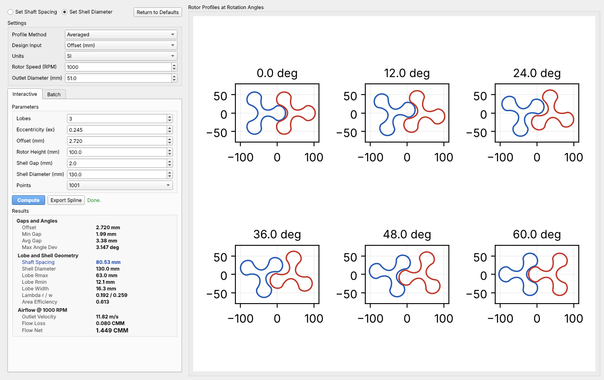
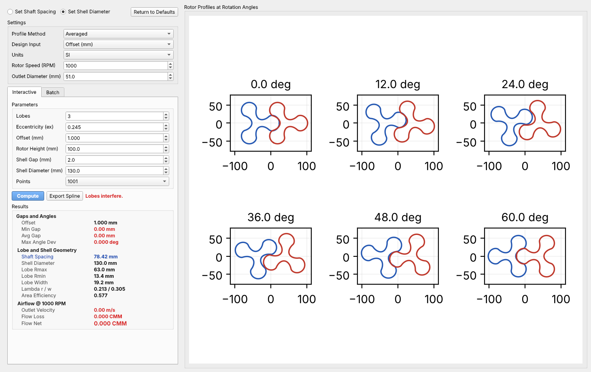

# RootsDesigner

Latest stable release: **v0.4.0**

RootsDesigner is a design tool for a family of high-flow Roots blower rotor
profiles. The profiles are generated by a circle rolling inside and outside the
pitch curve of identical non-circular gears. With eccentricity ε = 0 the pitch
curve is a circle and the result is the classic epicycloid/hypocycloid (EH)
profile. With ε > 0 the lobes become non-circular and sweep more area, which
gives substantially more flow from the same housing.

For each design the program reports clearances, lobe and shell geometry and
airflow, plots the two rotors meshing at six rotation angles, and can export the
profile as a CSV spline that loads into Autodesk Fusion for building 3D models.

The same program is provided in two versions with the same functionality:

| File | What it is |
|---|---|
| `RootsProfileApp.m` | MATLAB App Designer app |
| `roots_app_qt.py` | Python desktop app (PySide6 GUI) |
| `roots_profile.py` | Python calculation core, also usable from the command line |
| `INSTALL.txt` | Step-by-step Python installation instructions |
| `License.txt` | License terms |



## What's new in v0.4.0

**Profile methods**
- New **Profile Method** setting:
  - **Averaged** (default) is the fixed-ratio construction of the paper (Eqs 5–6).
    It reproduces v0.3 profiles and spline CSVs exactly.
  - **Noslip rolling** rolls the circle along the pitch curve without slipping.
    At ε = 0 both methods give the same true EH profile.

**Design inputs**
- New **Design Input** setting: enter the **Offset**, the **Min Gap** or the
  **Max Angle Dev**. With Min Gap or Max Angle Dev, the program solves for the
  smallest offset that reaches the target, and the other two values become
  outputs. If the solved value jumps past the target, the next larger value is
  used and shown in red with an explanatory note.
- **Rotor Speed (RPM)** input replaces the fixed 1000 RPM.
- **Units** setting: **SI** (flow in CMM, velocity in m/s) or **Imperial**
  (CFM, ft/min). Dimensions are always entered in mm.
- New **Outlet Velocity** output, computed from net flow and an
  **Outlet Diameter** input (default 51 mm).
- Rotor height, shell gap, shaft spacing, shell diameter and offset have no
  practical upper limit.
- The app starts in **Set Shell Diameter** mode (130 mm housing). A
  **Return to Defaults** button restores that mode, 1000 RPM, 100 mm rotor
  height, the Averaged method and the default 3-lobe parameters. The Units
  choice is kept.

**Results**
- Results are grouped into **Gaps and Angles**, **Lobe and Shell Geometry**
  and **Airflow**, with net flow last. Batch columns follow the same order.
- Lobe Rmax and Rmin are now measured from the generated profile rather than
  estimated. Before, they came out 0.6–1.0 mm low for eccentric profiles. Shell
  diameter, area efficiency, λ and flow are corrected to match.
- λ is reported as **λr / λw**, as defined in the paper.
- **Max Angle Dev** is now the smallest angular play before contact at any
  close approach of the lobes over a full rotation. It was previously taken
  only at the single minimum-gap position, which could miss a tighter position
  and made the value jump as parameters changed.
- When the lobes interfere (negative gap or a self-intersecting profile), the
  gap, angle, velocity and flow outputs are shown as 0 in red.
- Small loops that the offset left at the cusps of ε = 0 profiles are trimmed.



**Batch mode**
- Batch Defaults works in both modes. In Set Shell Diameter mode it loads the
  130 mm housing cases of the paper's Table 3.
- Batch column 3 follows the Design Input choice, so a batch can solve every
  row for a target Min Gap or Max Angle Dev.
- Failed rows are shown in red with the reason (hover in Python, an alert in
  MATLAB).
- Fixed: a batch using Max Angle Dev as the design input ran very slowly, and
  closing the Python window during a batch crashed Python. Max Angle Dev now
  checks each distinct close approach only once, Cancel stops a running batch
  promptly, and closing the window during a run is safe.

**Speed**
- Gap analysis uses a nearest-vertex search instead of comparing all vertex
  pairs, so it runs faster. Results are unchanged for non-interfering rotors.

## Running the app

### MATLAB

Requires MATLAB R2019b or newer. No toolboxes are needed. Open MATLAB in the
RootsDesigner folder and run:

```matlab
RootsProfileApp
```

### Python

Requires Python 3.9 or newer with numpy, scipy, matplotlib (3.5 or newer) and
PySide6. See `INSTALL.txt` for detailed steps, including how to avoid an old
Anaconda Python. In short:

```bash
python3 -m venv ~/roots_venv
source ~/roots_venv/bin/activate        # Windows: %USERPROFILE%\roots_venv\Scripts\activate
pip install numpy scipy matplotlib PySide6
python3 roots_app_qt.py
```

The calculation core can also be run without the GUI:

```bash
python3 roots_profile.py                          # default 3-lobe design
python3 roots_profile.py --mode sd --ss-or-shelld 130
python3 roots_profile.py --nodes 4 --ex 0.3 --method noslip
python3 roots_profile.py --min-gap 2              # solve offset for a 2 mm gap
python3 roots_profile.py --max-angle-dev 3        # solve offset for 3 deg of play
python3 roots_profile.py --help
```

## Using the app

**Mode.** Choose **Set Shaft Spacing** to enter the shaft spacing and get the
shell diameter, or **Set Shell Diameter** to enter the housing bore and have the
shaft spacing solved for.

**Settings** (above the tabs, shared by both tabs): Profile Method, Design
Input, Units, Rotor Speed and Outlet Diameter.

**Interactive tab.** Set the parameters and press **Compute**:

| Parameter | Meaning |
|---|---|
| Lobes | Number of lobes per rotor (2 to 10) |
| Eccentricity (ex) | Eccentricity ε of the pitch curve. 0 gives the EH profile; larger values give more flow but thinner lobe necks |
| Offset / Min Gap / Max Angle Dev | The clearance input chosen under Design Input |
| Rotor Height | Axial length of the rotors (mm) |
| Shell Gap | Radial clearance between lobe tips and the housing (mm) |
| Shaft Spacing or Shell Diameter | Depends on the mode (mm) |
| Points | Number of points in the generated profile |

**Export Spline** writes the computed profile as a CSV of x, y, z points in cm,
ready to import as a spline in Autodesk Fusion.

**Batch tab.** Load the default cases with **Defaults** or build a table with
**Add Row** and **Delete**, then press **Run All**. Tick **Plot?** on rows and
press **Plot** to overlay their profiles, or click a result row to plot it.
**Export** saves the inputs, settings and results to a CSV file.

### Checking a design against limits

The app reports values but does not enforce design limits such as a minimum
lobe width or a minimum Rmin. When you compare a result with a limit, a value
counts as meeting the limit when it rounds to it at the displayed precision
(0.1 mm for lengths). For example, a lobe width of 4.96 mm displays as 5.0 mm
and meets a 5.0 mm minimum width. The design tables in the paper use the same
rule.

## Version history

- **v0.4.0**: Averaged and Noslip rolling profile methods, Design Input
  (Offset, Min Gap or Max Angle Dev), RPM input, SI/Imperial units, outlet
  velocity, measured Rmax/Rmin, revised Max Angle Dev, interference flagging,
  batch speed and crash fixes.
- **v0.3.0**: added Max Angle Deviation to the outputs, and added a Python
  version with the same functionality as the MATLAB version.

## Reference

Horst, Robert. "A family of high-flow Roots blower profiles based on
non-circular gears and the coin rotation paradox." engrXiv,
https://doi.org/10.31224/4850 (2026).

## License

This project is licensed under the Horst Tech Non‑Commercial Software License.
Internal use (including by companies) is permitted; use in commercial products
or paid services is not. See `License.txt` for the full terms.

Copyright © 2026 Horst Tech LLC
